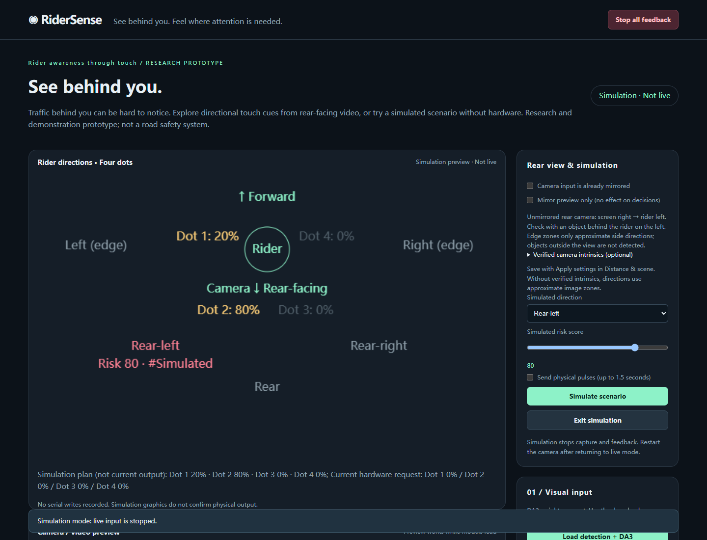

# RiderSense

**See behind you. Feel where attention is needed.**

Traffic behind you can be hard to notice while looking forward. RiderSense explores a different way to present that information: analyze rear-facing video on a computer and turn vehicle direction and a rule-based risk score into cues at four body-mounted DataFeel dots.

Try the direction map without any hardware, then connect your own camera or video. This is an open-source research and demonstration prototype, **not a road safety system**. Its 0–100 score is not a calibrated collision probability.



The screenshot shows synthetic scenario inputs in the running application. It is not a vehicle test or confirmation of physical feedback.

## What you can experience

- Explore five rider-relative directions and see the requested intensity for each dot.
- Analyze a computer camera, browser camera, or local video; pause, loop, or replay video from the start.
- See why vibration is inactive, including stale input, low score, missing devices, and simulation mode.
- Optionally connect four DataFeel dots for finite vibration patterns, timed heating/cooling, and LED control.

| Status | Features |
| --- | --- |
| Implemented | Hardware-free scenario preview, rear-camera coordinate conversion, five directions, four-dot rules, 0–100 scoring, camera/video controls, latest-frame scheduling, stop controls, VS Code launch |
| Experimental | YOLO tracking, DA3 depth estimates, single-point depth scale fit, optional DataFeel adapter, local HTTPS iPhone gateway |
| Roadmap | Quest-native capture, measured camera-to-skin latency, broader hardware/platform validation, stronger motion compensation |

DA3 provides depth estimation here. RiderSense does not implement a persistent 3D world model. Without verified scale, it uses image occupancy and growth, and leaves metric distance and speed unavailable.

## Quick Start — no hardware, SDK, GPU, or weights

Use Python **3.12** and Git. A current desktop browser is needed. The release is tested on Windows; see [validation](docs/validation.md) for exact environments and unverified platforms.

```powershell
git clone https://github.com/wqyorxyq/ridersense.git
cd ridersense
py -3.12 -m venv .venv
.venv\Scripts\python.exe -m pip install -r requirements.txt
.venv\Scripts\python.exe scripts/run_site.py
```

Open <http://127.0.0.1:8765>. In **Rear view & simulation**, choose a direction and score, leave **Send physical pulses** unchecked, and click **Simulate scenario**. Scroll to **Rider directions · Four dots**. Try rear-left at 80, rear at 60, and left at 30. No model download is needed.

On other operating systems, the equivalent commands use `python3.12 -m venv .venv` and `.venv/bin/python`; those platforms are unverified locally. In VS Code, select this virtual environment and use F5 or Ctrl+Shift+B (bundled launch paths target Windows). Stop with **Stop all feedback**, then Ctrl+C in the server terminal. A port conflict can be resolved with `--port 8875`; do not reuse an unknown background instance.

## Connect a camera or play a video

1. Install optional vision dependencies and explicitly download models using [the model setup guide](docs/models.md). Detection alone is sufficient for image-area scoring.
2. Click **Load detection only**, or **Load detection + DA3** after installing DA3.
3. Choose **Start laptop camera**, **Start browser camera**, or **Choose test video**. Supply your own authorized footage; none is bundled. H.264 MP4 is recommended for browser playback.
4. Wait for analyzed frames. For people rather than vehicles, enable **Indoor demo: also detect people** and apply settings.
5. With authorized SDK access and four connected dots, scan the controller, verify the wearing positions with gentle test pulses, then enable auto vibration.

Selecting a source exits simulation and clears old alerts. Simulation stops live capture. Pausing, ending video, hiding the page, or resetting a source disables feedback. After resuming, enable auto vibration again. Looping preserves arming but clears old tracking history and outputs at the loop boundary.

For an iPhone, use [local HTTPS setup, pairing, and cleanup](docs/iphone.md). There is no native iPhone or Quest application. Set `RIDER_CAMERA_INDEX` before launch to select a different computer camera (default `0`).

## Connect touch points

Hardware is disabled by default. The optional adapter expects a DataFeel Gen 10 controller and four dots at addresses 1–4. Obtain the SDK and any CP210x driver from their official providers under their own terms. **SDK, driver, manual, and vendor examples are not distributed here.** See [hardware installation](docs/hardware.md).

Thermal output is limited to 0.1–30 seconds at up to 30% requested intensity. Host-side temperature checks and timeouts are not a verified hardware watchdog. If the computer or USB fails, use the controller power switch. Physical execution and tactile accuracy remain unverified for this release.

## Configuration and feedback rules

The camera faces backward: unmirrored screen-right means rider-left. Normalize input mirroring once; preview mirroring only changes display. Without verified intrinsics, five image bands approximate direction; edge zones are not a guarantee of true side visibility.

| Rider direction | High risk (>70 on entry) | Medium risk (>40 on entry) |
| --- | --- | --- |
| Left edge | Dot 1, 80% | None |
| Rear-left | Dot 1, 20%; Dot 2, 80% | Dot 2, 20–50% |
| Rear | Dots 2 and 3, 80% each | Dots 2 and 3, equal 20–50% |
| Rear-right | Dot 3, 80%; Dot 4, 20% | Dot 3, 20–50% |
| Right edge | Dot 2, 80% | None |

Right-edge → Dot 2 is the existing rule, intentionally preserved. Verify placement before hardware use; it is not a universal wearing layout. Percentages are requested intensity and nominal SDK levels, not measured physical amplitude. See [scoring and architecture](docs/architecture.md) for formulas, hysteresis, timing, and configuration in `rider/alert_config.py`.

## Troubleshooting

**Video plays but does not vibrate:** check the on-screen reason. Models must be ready, simulation off, all four dots connected, frames fresh, auto vibration enabled, and score above the entry threshold. Medium-risk edge directions intentionally have no output. Video of people requires person detection. Pause or source changes require rearming.

**No metric distance:** expected until depth and a verified scale are available. Image-area scoring works without DA3. A single-point fit is only a demonstration scale adjustment; validate at another distance. It does not establish real camera intrinsics.

**Camera permission failure:** browser capture requires localhost or trusted HTTPS. Check browser/OS camera permissions, camera switches, and other applications using the camera. Keep the phone page foregrounded.

**No devices or missing SDK:** follow [hardware setup](docs/hardware.md); do not install a similarly named package from an unknown source. Simulation remains usable. Multiple controllers require an explicit adapter port selection; the web scan expects one controller.

**Missing models:** nothing downloads on startup. Use the explicit commands in [models](docs/models.md). A large DA3 download requires roughly 1.34 GB plus temporary space; installation dependencies can take several GB.

## Performance, privacy, and limitations

[Validation and performance notes](docs/validation.md) distinguish current automated checks from historical local observations. Model inference time is not complete end-to-end latency. We have not measured sensor-to-skin latency or validated road safety outcomes.

Frames are processed by the local Python server. Browser/phone frames travel to that computer; the phone gateway uses local HTTPS. The app keeps the latest input/result in memory and does not intentionally record footage. Selected video remains a browser file; sampled frames are uploaded locally. Pairing tokens are held in browser session storage. Explicit package/model installation contacts upstream services. Optional dependencies may have their own settings; inspect those before sensitive use. No cloud inference or public tunnel is configured.

Occlusion, lighting, head movement, tracking changes, background depth, and uncalibrated scale can cause missed or incorrect cues. Camera motion filtering is partial. Objects outside the view cannot be detected. Use only controlled demonstrations.

## Contributing and license

Start with [CONTRIBUTING.md](CONTRIBUTING.md), the issue templates, and [SECURITY.md](SECURITY.md). Keep CI hardware-free and preserve bounded outputs and input-expiry behavior.

RiderSense application source is **AGPL-3.0-only**; see [LICENSE](LICENSE). This project uses [Ultralytics YOLO](https://github.com/ultralytics/ultralytics), licensed under AGPL-3.0. This choice accommodates the integrated detector and publishes the complete application source, frontend, configuration, and tests. Network users have a source link in the dashboard. Third-party rights remain separate; this is not an unconditional commercial-use grant. See [THIRD_PARTY_NOTICES.md](THIRD_PARTY_NOTICES.md) and [MODEL_LICENSES.md](MODEL_LICENSES.md).
